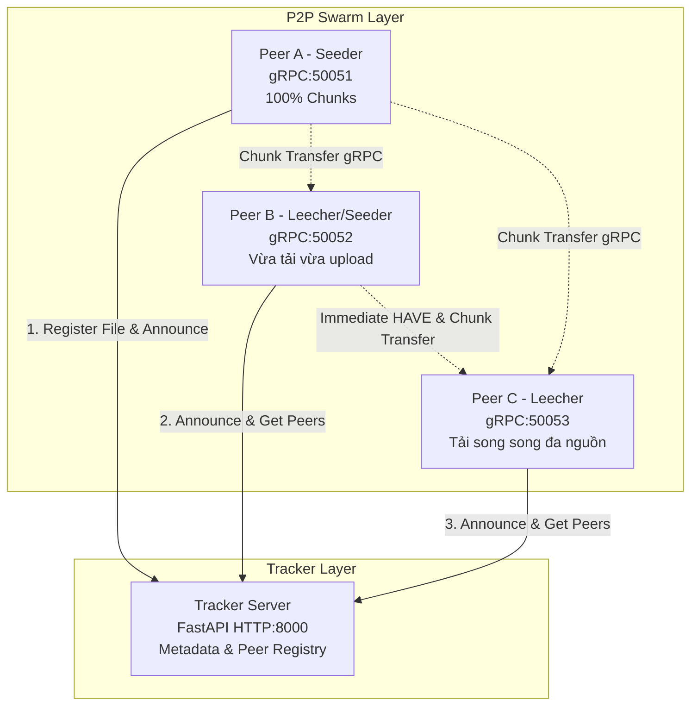

# DS02 – Hệ Thống Chia Sẻ File P2P Mô Phỏng BitTorrent

> **Môn học:** Distributed Systems (Hệ phân tán) – Course Project  
> **Mã đề tài:** DS02  
> **Khái niệm trọng tâm:** P2P, Tracker, Chunking & Replication, Parallel Downloading, Concurrency Lock, Fault Tolerance & Churn.  
> **Công nghệ:** Python 3.11+, FastAPI (Tracker HTTP/REST), gRPC & Protocol Buffers (Peer Data Stream), AsyncIO, Docker.

---

## 👥 Bảng Phân Công Công Việc (Task Assignment Table)

*(Theo yêu cầu Mục 13 – Mỗi thành viên phụ trách một phần việc cụ thể và có commit đóng góp)*

| STT | Thành viên | MSSV | Phần phụ trách | Module / Thư mục |
|:---:|---|---|---|---|
| 1 | **Lỗ Mạnh Trường** | *(Điền MSSV)* | Tracker Server, API Authentication, Metadata Generator, Protocol Buffers | `src/tracker/`, `src/common/` |
| 2 | **Bùi Trung Kiên** | *(Điền MSSV)* | Peer Engine, Download Manager, Rarest-First, Piece Manager, Atomic I/O Lock | `src/peer/` |
| 3 | **Phạm Nguyễn Dũng** | *(Điền MSSV)* | Bộ kiểm thử tự động (15 tests), Kịch bản Demo lỗi & đo hiệu năng, Docker Deploy | `tests/`, `scripts/`, `deploy/`, `docs/` |

---

## 🏛️ Kiến Trúc Hệ Thống



> ⚠️ **Cam kết nguyên tắc BitTorrent:** Tracker **chỉ quản lý metadata và danh sách peer**; Tracker **tuyệt đối KHÔNG lưu trữ và KHÔNG cung cấp nội dung file**.

---

## 📂 Cấu Trúc Thư Mục Repository

```text
DS02_BitTorrent/
├── README.md                           # Tài liệu tổng quan, bảng phân công & hướng dẫn
├── requirements.txt                    # Danh sách thư viện phụ thuộc
├── .env.example                        # Template biến môi trường
├── .gitignore                          # Loại trừ secret .env, cache, file test tạm
├── src/
│   ├── common/                         # Dùng chung: config, hashing SHA-256, metadata, protobuf
│   │   ├── config.py
│   │   ├── hashing.py
│   │   ├── metadata.py
│   │   ├── peer.proto
│   │   ├── peer_pb2.py
│   │   └── peer_pb2_grpc.py
│   ├── tracker/                        # Tracker Server
│   │   └── tracker.py
│   └── peer/                           # Peer Node
│       ├── chunk_manager.py            # Piece Manager & Atomic Disk I/O Lock
│       ├── peer_servicer.py            # gRPC Server phục vụ chunk
│       └── peer_node.py                # Download engine, Rarest-first, Immediate HAVE
├── deploy/                             # Triển khai hệ thống
│   ├── Dockerfile
│   ├── docker-compose.yml
│   └── README.md
├── tests/                              # Bộ kiểm thử tự động (21 tests)
│   ├── test_functional.py              # 8 functional tests
│   ├── test_concurrency.py             # 2 concurrency tests
│   ├── test_fault_recovery.py          # 2 fault & recovery tests
│   ├── test_security.py                # 5 security / invalid-data tests
│   ├── test_performance.py             # 1 performance scalability test
│   └── test_engine.py                  # 3 test vòng tải tự động (đa nguồn, failover, chặn peer độc hại)
├── scripts/                            # Kịch bản thực thi & đo đạc
│   ├── demo_common.py                  # Tiện ích chung: quản lý tiến trình, đọc log, bảng bằng chứng
│   ├── demo_all.py                     # Demo KB1, KB2, KB3, KB7 (4 tiến trình độc lập)
│   ├── demo_fault_injection.py         # Demo lỗi live KB4, KB5, KB6 (kill seeder, peer gửi chunk hỏng)
│   └── benchmark_performance.py        # Đo thời gian/throughput theo số peer & chunk size, xuất biểu đồ
└── docs/                               # Tài liệu học thuật & báo cáo
    ├── ARCHITECTURE.md                 # Thiết kế kiến trúc, giao thức, mô hình lỗi & đồng thời
    ├── REPORT_TEMPLATE.md              # Khung báo cáo kỹ thuật 19 mục chuẩn
    └── benchmark/                      # Kết quả đo hiệu năng (CSV, biểu đồ PNG, results.md)
```

---

## 🚀 Hướng Dẫn Cài Đặt & Chạy Trên Máy Sạch (Redeploy Guide)

### 1. Chuẩn bị môi trường
- Python 3.10 trở lên.
- Cài đặt các thư viện cần thiết:
```bash
pip install -r requirements.txt
```

### 2. Thiết lập biến môi trường
```bash
# Trên Windows PowerShell:
Copy-Item .env.example .env

# Trên Linux / macOS:
cp .env.example .env
```
Mở file `.env` và đổi `TRACKER_API_KEY` thành chuỗi bí mật của riêng bạn (không commit file `.env`):
```bash
python -c "import secrets; print(secrets.token_hex(16))"
```

---

## 🎬 7 Kịch Bản Demo Bắt Buộc (Mục 9)

| # | Kịch bản | Script | Bằng chứng trong log |
|:---:|---|---|---|
| 1 | Tạo metadata và chia sẻ file | `demo_all.py` | `[REGISTER]` (seeder), `Registered file` (tracker) |
| 2 | Tải song song từ ≥ 2 peer | `demo_all.py` | `[SUMMARY] Chunks received per source peer -> A: x, B: y` |
| 3 | Peer upload trước khi tải xong | `demo_all.py` | `[UPLOAD] ... own 20/32 chunks - STILL DOWNLOADING` |
| 4 | Tắt một source trong lúc tải | `demo_fault_injection.py` | `[PEER DOWN] Cannot reach ...` |
| 5 | Chuyển sang source khác | `demo_fault_injection.py` | `[FAILOVER] Re-requesting chunk X from ...` |
| 6 | Phát hiện chunk không hợp lệ | `demo_fault_injection.py` | `[HASH MISMATCH]`, `[INTEGRITY FAULT]` |
| 7 | Ghép file và verify hash cuối | cả hai | `[VERIFY] SUCCESS: final file SHA-256 matches` |

### Cách 1: Chạy Tự Động (Khuyến nghị cho buổi Demo)

Mỗi node (Tracker, Seeder, Leecher) chạy trong **một tiến trình riêng**, có thư mục dữ liệu riêng và file log riêng.
Script chỉ bật/tắt tiến trình và đọc log; dữ liệu file chỉ đi giữa các peer qua gRPC.
Cuối mỗi script in **bảng bằng chứng** (ĐẠT / CHƯA ĐẠT) kèm các dòng log chứng minh.

1. **Demo Hoạt Động Bình Thường (KB 1, 2, 3, 7)** – khoảng 15 giây:
   ```bash
   python scripts/demo_all.py
   ```
   Tracker (8000), Seeder (6881), Leecher 1 (6882), Leecher 2 (6883). Upload mỗi peer giới hạn 512 KB/s
   để quan sát được tải song song trên cùng một máy. Log: `demo_workspace/demo_all/logs/`.

2. **Demo Lỗi Live & Phục Hồi (KB 4, 5, 6)** – khoảng 35 giây:
   ```bash
   python scripts/demo_fault_injection.py               # cả hai phần
   python scripts/demo_fault_injection.py --part crash  # chỉ KB4, KB5
   python scripts/demo_fault_injection.py --part corrupt # chỉ KB6
   ```
   - **Phần A:** khi Leecher tải được ~25% file, script **kill hẳn tiến trình Seeder 1** (crash-stop).
     Leecher tự phát hiện, phạt điểm, tự yêu cầu lại chunk từ Seeder 2 và hoàn thành file đúng hash.
   - **Phần B:** Bad Seeder chạy với cờ `--corrupt` gửi dữ liệu sai qua gRPC. Leecher phát hiện sai SHA-256,
     từ chối ghi đĩa, chặn peer độc hại và tải lại toàn bộ từ Good Seeder.
   - Log: `demo_workspace/fault_crash/logs/`, `demo_workspace/fault_corrupt/logs/`.

3. **Chạy Thí Nghiệm Hiệu Năng & Đo Đạc Thông Lượng:**
   ```bash
   python scripts/benchmark_performance.py           # đầy đủ (~1 phút)
   python scripts/benchmark_performance.py --quick   # chạy nhanh để thử
   ```
   Kết quả (CSV, biểu đồ PNG, bảng Markdown) được lưu trong `docs/benchmark/`.

---

### Cách 2: Chạy Từng Tiến Trình Bằng Tay Trong Nhiều Terminal

Mỗi terminal mở tại thư mục gốc repo và đã kích hoạt môi trường ảo.

**Terminal 1: Khởi động Tracker Server**
```bash
python src/tracker.py --port 8000
```

**Terminal 2: Tạo dữ liệu mẫu, metadata và chạy Seeder**
```bash
# Tạo file mẫu 4 MB (16 chunk x 256 KB)
python -c "import os; open('demo.bin', 'wb').write(os.urandom(4*1024*1024))"

# Sinh metadata .torrent.json
python src/metadata.py demo.bin http://127.0.0.1:8000

# Seeder, giới hạn upload 512 KB/s
python src/peer_node.py --port 6881 --metadata demo.bin.torrent.json --output demo.bin --seed --upload-limit 512
```

**Terminal 3 và 4: Hai Leecher (bật liền nhau)**
```bash
python src/peer_node.py --port 6882 --metadata demo.bin.torrent.json --output download_1.bin --upload-limit 512
python src/peer_node.py --port 6883 --metadata demo.bin.torrent.json --output download_2.bin --upload-limit 512
```

**Lỗi live bằng tay:**
- *Tắt source (KB4, KB5):* chạy thêm một seeder thứ hai ở cổng 6884, bật leecher, rồi **đóng hẳn cửa sổ terminal** của seeder 6881 khi đang tải.
- *Chunk hỏng (KB6):* chạy một seeder với thêm cờ `--corrupt`, ví dụ:
  ```bash
  python src/peer_node.py --port 6885 --metadata demo.bin.torrent.json --output demo.bin --seed --corrupt --upload-limit 512
  ```

Nhấn `Ctrl + C` để dừng từng node (peer gửi `/leave` cho tracker trước khi thoát).

---

## 🧪 Kiểm Thử Tự Động (Automated Testing Suite)

Hệ thống đi kèm **21 bài kiểm thử tự động** thỏa mãn đầy đủ yêu cầu Mục 11:

```bash
# Chạy toàn bộ tests:
pytest tests/ -v
```

### Thống kê bài kiểm thử:
- **Functional Tests (8 bài):** Băm file/chunk, chia/ghép file, đăng ký tracker, announce & lấy peer, timeout TTL, rời mạng graceful, tải từ 1 seeder, tải song song đa nguồn.
- **Concurrency Tests (2 bài):** Khóa `asyncio.Lock()` khi nhiều luồng cùng ghi đĩa; Seeder phục vụ nhiều peer đồng thời.
- **Fault & Recovery Tests (2 bài):** Chịu lỗi peer sập nguồn giữa chừng (failover); ngắt tiến trình và khôi phục tiếp tục tải (Resume).
- **Security & Data Validation Tests (5 bài):** Chặn truy cập không có/sai `X-API-Key`; bắt lỗi chunk sai hash SHA-256; gRPC từ chối chunk index ngoài phạm vi và file_id lạ; tracker từ chối announce sai định dạng và lọc chunk index không hợp lệ; từ chối message vượt giới hạn 4 MB.
- **Performance Test (1 bài):** Đo thời gian và thông lượng giữa tải đơn nguồn và tải đa nguồn.
- **Engine Tests (3 bài):** Chạy đúng vòng tải tự động `download_manager_loop()`: tự chia chunk cho nhiều nguồn; tự failover khi seeder bị tắt giữa chừng; tự từ chối và chặn peer gửi chunk hỏng.

---

## 🐳 Triển Khai Với Docker Compose

Khởi động toàn bộ mạng P2P cô lập gồm 1 Tracker, 1 Seeder và 2 Leecher chỉ với 1 lệnh (cần tạo file `.env` trước):
```bash
docker compose -f deploy/docker-compose.yml up --build
```
Kiểm tra trạng thái mạng P2P từ máy host (thay `<API_KEY>` bằng giá trị trong `.env`):
```bash
curl -H "X-API-Key: <API_KEY>" http://localhost:8000/stats
```
Dọn dẹp container:
```bash
docker compose -f deploy/docker-compose.yml down -v
```
Chi tiết xem `deploy/README.md`.
