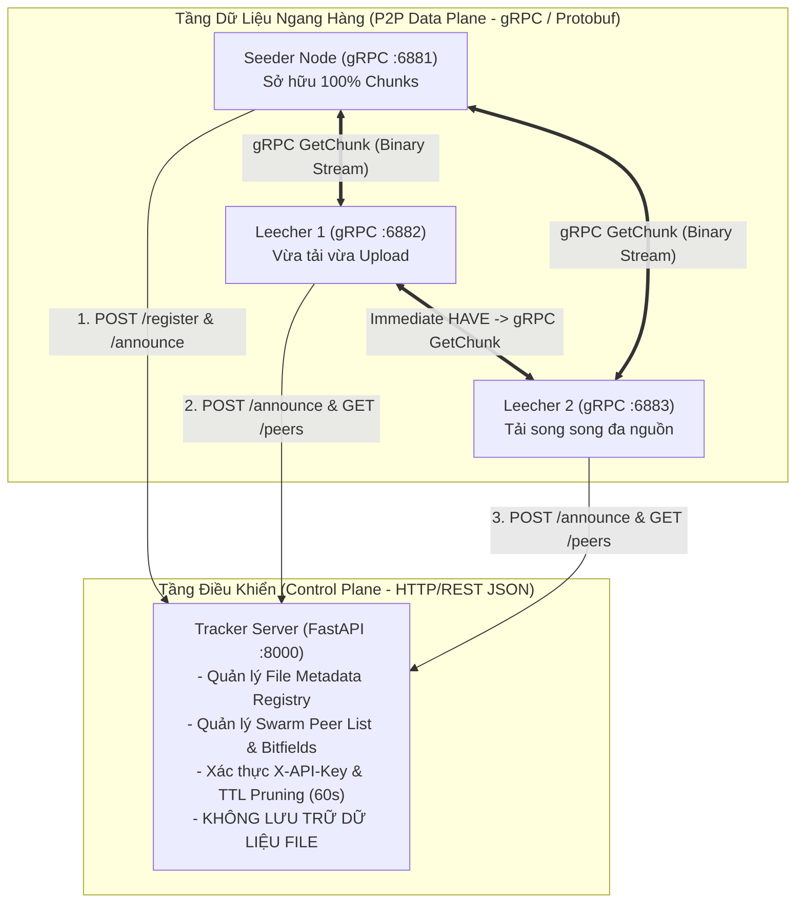
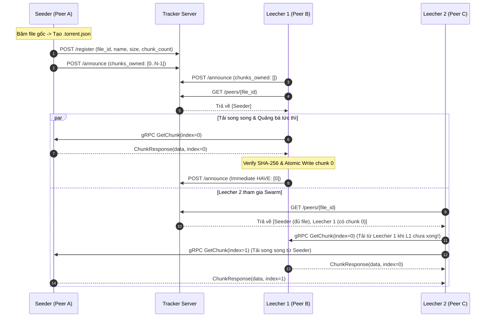
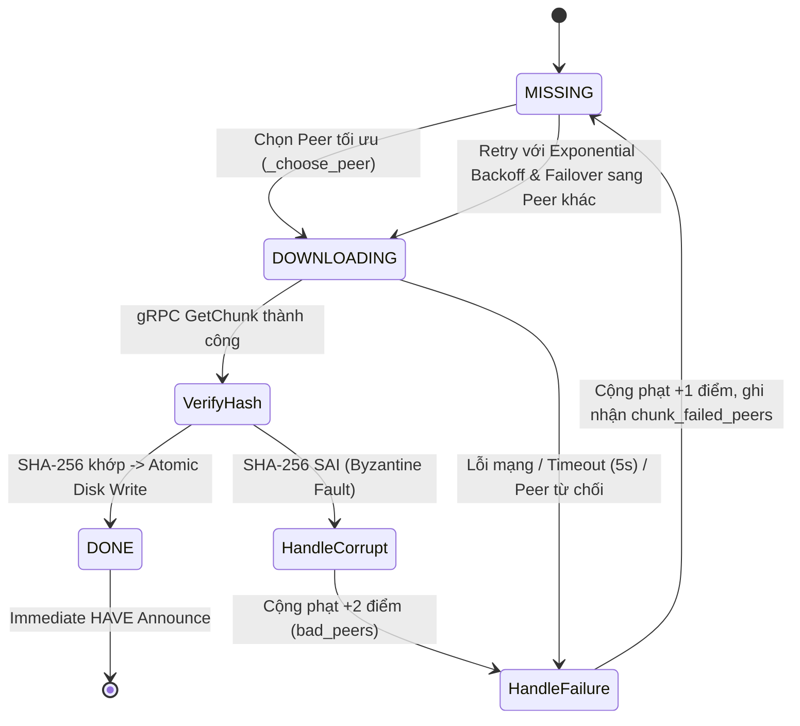
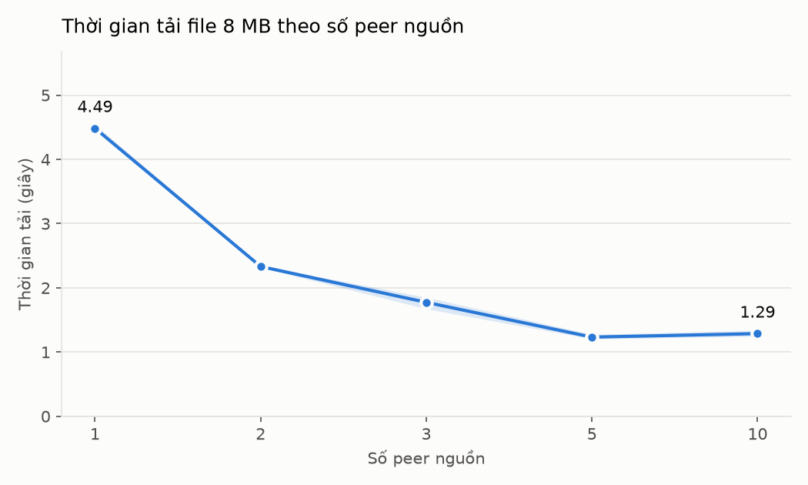
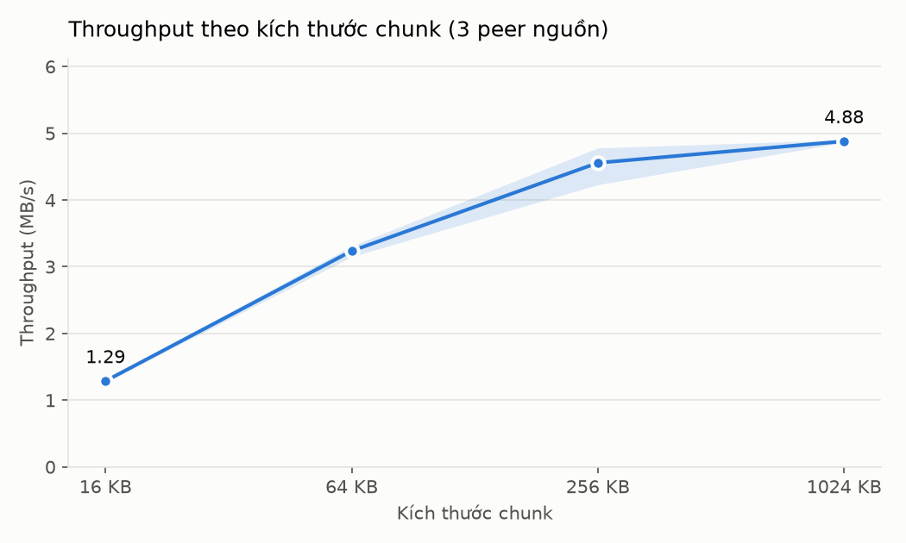

# BÁO CÁO KỸ THUẬT MÔN HỌC HỆ PHÂN TÁN (DISTRIBUTED SYSTEMS)
## ĐỀ TÀI DS02: HỆ THỐNG CHIA SẺ FILE NGANG HÀNG (P2P) MÔ PHỎNG GIAO THỨC BITTORRENT

---

## 1. TRANG BÌA

- **Trường / Học viện:** Học viện Công nghệ Bưu chính Viễn thông (PTIT)
- **Môn học:** Hệ phân tán (Distributed Systems – Course Project)
- **Mã đề tài:** DS02 – P2P File Sharing System Simulating BitTorrent
- **Giảng viên hướng dẫn:** *(Điền tên Giảng viên hướng dẫn)*
- **Nhóm thực hiện:**
  1. **Lỗ Mạnh Trường** – MSSV: `B23DCAT308`
  2. **Bùi Trung Kiên** – MSSV: `B23DCDT148`
  3. **Phạm Nguyễn Dũng** – MSSV: `B23DCVT109`
- **Repository GitHub:** https://github.com/manhtruong43/DS02---P2P-file-sharing-system-simulating-BitTorrent-.git
- **Phiên bản bàn giao:** `v1.0.0` (Tháng 11/2026)

---

## 2. THÔNG TIN NHÓM VÀ PHÂN CÔNG CÔNG VIỆC

Dự án được chia thành 3 phân hệ độc lập nhưng gắn kết chặt chẽ thông qua giao diện giao thức (REST JSON và Protocol Buffers). Mỗi thành viên chịu trách nhiệm thiết kế, lập trình, kiểm thử và đóng góp trực tiếp trên nhánh chính của GitHub:

| STT | Họ và Tên | MSSV | Phần việc phụ trách chính | Thư mục / Module | Bằng chứng Commit trên GitHub |
|:---:|---|---:|---|---|---|
| 1 | **Lỗ Mạnh Trường** | `B23DCAT308` | Thiết kế và cài đặt **Tracker Server** (FastAPI), xác thực API Key (không có key mặc định, không ghi key vào log, fail closed), cơ chế quản lý liveness/TTL, bộ sinh **Metadata Generator** (`.torrent.json`) kèm kiểm tra metadata khi sinh và khi đọc, hàm băm SHA-256 và định nghĩa **Protocol Buffers**. | `src/tracker/`, `src/common/` | `426b36e`, `d20297b`, `6d53d0e`, `118ffa2`, `4b7c547` |
| 2 | **Bùi Trung Kiên** | `B23DCDT148` | Thiết kế và cài đặt **Peer Node Engine**, **gRPC Server/Client**, thuật toán chọn mảnh **Rarest-First**, cân bằng tải đa nguồn, cơ chế **Immediate HAVE/Announce**, **Piece Manager**, khóa đồng thời **Atomic Disk I/O Lock**, giới hạn băng thông, **Resume Download**, xác minh file nguồn của seeder, xác minh hash toàn file (phân biệt tải thành công/thất bại) và retry đăng ký tracker. | `src/peer/` | `d10a860`, `dab730a`, `9333247` |
| 3 | **Phạm Nguyễn Dũng** | `B23DCVT109` | Xây dựng bộ **31 bài kiểm thử tự động** (`pytest`), kịch bản **Demo 7 kịch bản bắt buộc** (bao gồm tiêm lỗi live crash-stop & corrupt chunk), kịch bản **Benchmark hiệu năng** đo trên engine tải thật (xuất CSV & biểu đồ), đóng gói **Docker Compose** (healthcheck, volume riêng từng node) và biên soạn tài liệu. | `tests/`, `scripts/`, `deploy/`, `docs/` | `443f1bb`, `a7c2c46`, `6185c6e`, `8355eaa`, `64bc661`, `8b31fe1`, `a53b108`, `ef1a51f` |

---

## 3. TÓM TẮT (ABSTRACT)

Trong các hệ thống phân phối tệp tin theo mô hình Khách – Chủ (Client – Server) truyền thống, máy chủ trung tâm luôn là điểm nghẽn cổ chai (bottleneck) về băng thông và là điểm lỗi đơn (Single Point of Failure) khi số lượng người dùng tải xuống tăng đột biến. Giao thức chia sẻ tệp ngang hàng (Peer-to-Peer – P2P) tiêu biểu như **BitTorrent** giải quyết triệt để bài toán này bằng cách chia nhỏ tệp tin thành các mảnh dữ liệu độc lập (chunks/pieces) và biến mỗi nút đang tải tệp (Leecher) thành một nguồn cung cấp dữ liệu cho các nút khác ngay khi nó sở hữu những mảnh đầu tiên.

Báo cáo này trình bày chi tiết quá trình phân tích, thiết kế, cài đặt và đánh giá một hệ thống chia sẻ tệp P2P mô phỏng BitTorrent hoàn chỉnh mang mã hiệu **DS02**. Hệ thống kết hợp kiến trúc lai (Hybrid P2P): sử dụng **Tracker Server** viết bằng **FastAPI (HTTP/REST)** chỉ để điều phối danh sách nút và thông tin mô tả tệp (tuyệt đối không lưu trữ hay truyền tải dữ liệu tệp), kết hợp với mạng lưới **Peer Swarm** giao tiếp trực tiếp qua **gRPC và Protocol Buffers** trên nền tảng bất đồng bộ **Python AsyncIO**.

Hệ thống đạt được đầy đủ các mục tiêu cốt lõi và nâng cao của một hệ phân tán hiện đại:
1. Chia nhỏ tệp tin và xác thực toàn vẹn hai tầng bằng mật mã **SHA-256** (cấp độ từng mảnh và toàn bộ tệp).
2. Tải song song từ nhiều nguồn đồng thời dựa trên thuật toán ưu tiên mảnh hiếm nhất (**Rarest-First**) kết hợp chọn nút ít tải nhất (**Least-Loaded Peer Selection**).
3. Cơ chế quảng bá mảnh tức thì (**Immediate HAVE / Announce**) cho phép một nút chia sẻ lại dữ liệu ngay trong khi vẫn đang tải.
4. Kiểm soát đồng thời an toàn với khóa bất đồng bộ (`asyncio.Lock`) cho cả thao tác ghi đĩa ngẫu nhiên và bảng trạng thái Tracker.
5. Chịu lỗi và tự phục hồi trước hiện tượng nút rời mạng đột ngột (**Crash-Stop Churn**), lỗi mạng tạm thời (**Bounded Exponential Backoff & Failover**), nút gửi dữ liệu sai (**Corrupt Chunk Rejection & Blacklisting**), khôi phục tiến trình tải bị gián đoạn (**Resume Download**), Tracker khởi động chậm hoặc khởi động lại (**Retry đăng ký & tự đăng ký lại**).
6. Được kiểm chứng qua **31 bài kiểm thử tự động**, các kịch bản tiêm lỗi trực tiếp (live fault injection) và thí nghiệm hiệu năng đo trên chính engine tải: hệ số tăng tốc (**Speedup**) đạt **1.92 lần** với 2 nút nguồn và **3.64 lần** với 5 nút nguồn.

---

## 4. MÔ TẢ BÀI TOÁN VÀ YÊU CẦU HỆ THỐNG

### 4.1. Động lực và Bài toán đặt ra
Khi phân phối một tệp tin dung lượng lớn $F$ cho $N$ người dùng:
- **Mô hình Client – Server:** Máy chủ phải tải lên tổng dung lượng $N \times F$. Nếu băng thông tải lên của máy chủ là $U_s$, thời gian tối thiểu để phục vụ toàn bộ người dùng tỷ lệ thuận tuyến tính với $N$: $T_{\min} \ge \frac{N \times F}{U_s}$. Khi $N$ lớn, máy chủ quá tải.
- **Mô hình P2P BitTorrent:** Tệp $F$ được chia thành $M$ mảnh có kích thước cố định (ví dụ 256 KB). Mỗi peer $i$ đóng góp thêm băng thông tải lên $u_i$. Tổng công suất phục vụ của toàn hệ thống trở thành $U_s + \sum_{i=1}^{N} u_i$, tự động mở rộng (self-scaling) khi số lượng người tham gia tăng lên.

### 4.2. Yêu cầu Chức năng (Functional Requirements)
1. **Sinh Metadata (`.torrent.json`):** Trích xuất thông tin tệp gốc gồm định danh duy nhất (`file_id`), tên tệp, kích thước, kích thước chunk, số lượng chunk, danh sách mã băm SHA-256 của từng chunk (`chunk_hashes`), mã băm SHA-256 của toàn tệp (`file_hash`) và danh sách URL của Tracker.
2. **Quản lý Swarm trên Tracker:** Hỗ trợ Seeder đăng ký tệp mới (`/register`), các Peer báo cáo danh sách mảnh đang sở hữu (`/announce`), duy trì kết nối sống (`/heartbeat`), truy vấn danh sách peer đang hoạt động (`/peers/{file_id}`) và thông báo rời mạng chủ động (`/leave`).
3. **Tải song song đa nguồn (Parallel Multi-Source Download):** Một Leecher phải kết nối và tải đồng thời nhiều chunk từ ít nhất 2 peer nguồn khác nhau, có giới hạn số tác vụ tải đồng thời (`MAX_CONCURRENT_DOWNLOADS`).
4. **Vừa tải vừa chia sẻ (Upload while Downloading):** Ngay khi một Leecher tải xong và xác thực thành công một chunk, nó phải có khả năng phục vụ chunk đó cho các Leecher khác mặc dù bản thân chưa tải xong toàn bộ tệp.
5. **Toàn vẹn và Lưu trữ:** Kiểm tra SHA-256 của từng chunk trước khi ghi xuống đĩa; ghép các chunk đúng vị trí độ lệch byte (offset); kiểm tra SHA-256 toàn bộ tệp sau khi hoàn tất; hỗ trợ tiếp tục tải lại (Resume) từ các mảnh đã có trên đĩa khi khởi động lại.

### 4.3. Yêu cầu Phi chức năng (Non-Functional Requirements)
- **Tính phân tán thực sự:** Các nút (Tracker, Seeders, Leechers) chạy trên các tiến trình hệ điều hành độc lập hoặc các container Docker cô lập, chỉ giao tiếp qua giao thức mạng (HTTP và gRPC), tuyệt đối không dùng bộ nhớ chia sẻ hay tệp dùng chung để truyền dữ liệu tệp.
- **Nguyên tắc cốt lõi của DS02:** Tracker chỉ lưu trữ siêu dữ liệu (metadata) và danh sách địa chỉ peer; **Tracker tuyệt đối không lưu trữ và không truyền tải bất kỳ byte nội dung nào của tệp tin**.
- **Tính chịu lỗi (Fault Tolerance):** Hoạt động ổn định khi có nút nguồn bị tắt đột ngột giữa chừng hoặc có nút gửi dữ liệu hỏng/độc hại.
- **Bảo mật (Security):** Xác thực truy cập Tracker bằng khóa bí mật (`X-API-Key`) nạp từ biến môi trường, kiểm tra hợp lệ toàn bộ đầu vào và giới hạn kích thước thông điệp mạng.

---

## 5. CÁC VẤN ĐỀ CỦA HỆ PHÂN TÁN TRONG ĐỀ TÀI DS02

Việc thiết kế hệ thống P2P đặt ra 5 bài toán kinh điển của hệ phân tán:

### 5.1. Tại sao Tracker tuyệt đối không giữ nội dung tệp?
Nếu Tracker lưu trữ và truyền dữ liệu tệp, hệ thống sẽ suy biến về mô hình Client – Server tập trung. Bằng cách tách rời **Luồng điều khiển (Control Plane – đi qua Tracker)** và **Luồng dữ liệu (Data Plane – đi trực tiếp giữa các Peer)**, lưu lượng băng thông mà Tracker phải xử lý chỉ là các gói tin JSON nhỏ gọn (vài trăm byte mỗi chu kỳ announce), giúp một máy chủ Tracker đơn lẻ có thể điều phối hàng chục nghìn peer mà không tốn băng thông mạng hay dung lượng ổ cứng.

### 5.2. Định danh (Naming/Identity) và Khám phá nút (Peer Discovery)
Trong mạng P2P động, các nút không biết trước địa chỉ IP và cổng dịch vụ của nhau. Hệ thống cần một cơ chế định danh duy nhất cho từng tệp tin (dựa trên nội dung mật mã học để tránh xung đột tên) và định danh duy nhất cho mỗi nút mạng, đồng thời cung cấp cơ chế để một nút mới tham gia (bootstrap) tìm thấy các nút đang nắm giữ dữ liệu.

### 5.3. Đồng thời và Xung đột Tài nguyên (Concurrency & Race Conditions)
- **Tại Peer:** Khi tải song song 5 chunk cùng lúc, 5 coroutine/luồng có thể hoàn thành cùng thời điểm và cùng thực hiện thao tác `seek()` + `write()` lên một tệp đích duy nhất trên đĩa, gây nguy cơ lệch con trỏ tệp (file pointer corruption) hoặc ghi đè dữ liệu nếu không có khóa đồng bộ.
- **Tại Tracker:** Hàng chục peer có thể gửi yêu cầu `/announce` và `/peers` đồng thời, gây xung đột đọc – ghi (Read-Write conflict) trên từ điển lưu trữ trạng thái swarm trong bộ nhớ.

### 5.4. Biến động mạng (Churn) và Sự không đồng bộ thời gian
Các nút trong mạng P2P có thể tham gia hoặc rời bỏ mạng bất kỳ lúc nào mà không báo trước (do mất điện, rớt mạng, hoặc bị người dùng tắt tiến trình). Vì trong hệ phân tán không có đồng hồ toàn cục hoàn hảo và không thể phân biệt tức thì một nút bị chậm mạng với một nút đã chết, hệ thống phải kết hợp cơ chế **Timeout ở tầng truyền vận (gRPC deadline)** tại phía Client và cơ chế **Hợp đồng thuê theo thời gian (TTL/Lease Pruning)** tại phía Tracker.

### 5.5. Dữ liệu bất thường và Nút độc hại (Byzantine / Data Corruption Faults)
Trong môi trường mở, một peer có thể gửi dữ liệu rác (do lỗi phần cứng/mạng hoặc cố tình phá hoại nhằm làm hỏng tệp của người tải). Nếu Leecher ghi trực tiếp dữ liệu nhận được vào tệp đích và chỉ kiểm tra mã băm khi đã tải xong toàn bộ tệp (ví dụ tệp 1 GB), nó sẽ không thể biết mảnh nào bị hỏng để tải lại, dẫn đến lãng phí toàn bộ băng thông. Do đó, xác thực toàn vẹn ở mức từng mảnh (Chunk-level SHA-256 verification) là yêu cầu sống còn.

---

## 6. PHÂN TÍCH VÀ LỰA CHỌN GIẢI PHÁP CÔNG NGHỆ

### 6.1. So sánh Tracker tập trung và Bảng băm phân tán (DHT)

| Tiêu chí | Tracker Tập trung (Centralized Tracker) | Bảng băm phân tán (DHT – ví dụ Kademlia) |
|---|---|---|
| **Cơ chế tìm kiếm** | Truy vấn trực tiếp $O(1)$ tới máy chủ HTTP biết trước trong file `.torrent`. | Định tuyến qua nhiều bước nhảy $O(\log N)$ giữa các nút trong mạng. |
| **Độ trễ khởi tạo (Bootstrap Latency)** | Rất thấp (chỉ 1 RTT HTTP request là nhận đủ danh sách peer và bitfield). | Cao hơn (phải tìm kiếm hội tụ qua các bucket khoảng cách XOR). |
| **Tính nhất quán thông tin** | Dễ dàng đạt được góc nhìn toàn cục về độ hiếm của từng chunk trong swarm. | Chỉ thấy được một tập con các nút lân cận. |
| **Điểm yếu** | Nếu Tracker ngừng hoạt động, các peer mới không thể tìm thấy nhau (tuy nhiên các peer đã biết nhau vẫn tiếp tục truyền file). | Độ phức tạp cài đặt và bảo mật cao (dễ bị tấn công Sybil/Eclipse). |

**Lựa chọn cho DS02:** Nhóm lựa chọn kiến trúc **Tracker Tập trung kết hợp P2P Swarm** vì phù hợp hoàn hảo với quy mô môn học, cho phép kiểm soát chính xác trạng thái bitfield toàn cục để tối ưu hóa thuật toán Rarest-First và dễ dàng quan sát, kiểm chứng log trong các kịch bản demo.

### 6.2. Lựa chọn Giao thức Giao tiếp: FastAPI (HTTP/REST) + gRPC (HTTP/2)
- **Giao tiếp Peer ↔ Tracker (Control Plane): HTTP/REST với FastAPI & Pydantic.**
  Các bản tin điều khiển (`/register`, `/announce`, `/peers`, `/leave`) có tần suất thấp và cấu trúc dữ liệu dạng danh sách/từ điển. Việc sử dụng JSON qua HTTP/REST giúp dễ dàng kiểm tra bằng công cụ chuẩn (`curl`, trình duyệt), đồng thời tận dụng khả năng kiểm tra kiểu dữ liệu (schema validation) tự động cực mạnh của Pydantic.
- **Giao tiếp Peer ↔ Peer (Data Plane): gRPC và Protocol Buffers trên nền HTTP/2.**
  Việc truyền tải hàng trăm mảnh dữ liệu nhị phân (binary chunks) đòi hỏi hiệu năng cao và chi phí đóng gói (serialization overhead) thấp. Khác với JSON (phải mã hóa dữ liệu nhị phân sang Base64 làm phình kích thước thêm 33%), **Protocol Buffers (`bytes` field)** truyền thẳng mảng byte nguyên gốc. Ngoài ra, **gRPC (`grpc.aio`)** hỗ trợ sẵn ghép kênh đa luồng (multiplexing) trên một kết nối TCP duy nhất, kiểm soát hạn thời gian (`timeout`) chặt chẽ và giới hạn kích thước thông điệp an toàn.

### 6.3. Phân tích Lựa chọn Kích thước Mảnh (Chunk Size)
Kích thước mỗi mảnh ($C$) là tham số đánh đổi quan trọng giữa **Chi phí quản lý/giao thức (Overhead)** và **Độ mịn tải song song (Parallelism & Pipelining)**:
- **Nếu $C$ quá nhỏ (ví dụ 16 KB):** Một tệp 8 MB bị chia thành 512 mảnh. Số lượng lời gọi RPC (`GetChunk`), số lần băm SHA-256, số lần `seek/write` đĩa và kích thước mảng `chunks_owned` gửi lên Tracker tăng gấp 16 lần so với chunk 256 KB. Thời gian chờ RTT của gRPC và HTTP announce chiếm ưu thế, làm giảm thông lượng thực tế.
- **Nếu $C$ quá lớn (ví dụ 1 MB – 3 MB, mức tối đa hệ thống cho phép):** Một tệp 8 MB chỉ có 8 mảnh. Khả năng phân tán tải cho nhiều peer bị hạn chế; một Leecher phải đợi tải xong cả 1 MB mới có thể kiểm tra hash và chia sẻ lại cho peer khác (tăng độ trễ pipelining); và nếu xảy ra lỗi mạng ở byte cuối cùng, peer phải tải lại toàn bộ 1 MB đó.
- **Lựa chọn mặc định ($C = 256\text{ KB}$):** Thực nghiệm ở Mục 15.3 cho thấy thông lượng tăng mạnh từ 16 KB lên 256 KB rồi gần như bão hòa (256 KB: `4.56 MB/s`, 1 MB: `4.88 MB/s`, chênh ~7%). Thí nghiệm đó chỉ có 1 leecher nên chưa đo được cái giá của chunk lớn (chia sẻ chéo giữa các leecher chậm hơn, mất nhiều dữ liệu hơn khi lỗi, ít mảnh để phân tán). Vì vậy nhóm chọn **256 KB** – mức BitTorrent thường dùng (BEP 0003) – làm điểm cân bằng: đã đạt gần mức thông lượng bão hòa mà vẫn giữ đủ nhiều mảnh để lan truyền song song.

---

## 7. KIẾN TRÚC TỔNG THỂ HỆ THỐNG

### 7.1. Sơ đồ Kiến trúc Phân tầng



### 7.2. Luồng Hoạt động Toàn trình (End-to-End Workflow)



---

## 8. THIẾT KẾ THÀNH PHẦN VÀ GIAO THỨC GIAO TIẾP

### 8.1. Cấu trúc File Siêu dữ liệu (`.torrent.json`)
Được xử lý bởi lớp `TorrentMetadata` trong `src/common/metadata.py`. File JSON chứa đầy đủ các trường bắt buộc theo Mục 5.1 của đặc tả:

```json
{
    "file_id": "e3b0c44298fc1c149afbf4c8996fb92427ae41e4649b934ca495991b7852b855",
    "file_name": "demo_file.bin",
    "file_size": 4194304,
    "chunk_size": 131072,
    "num_chunks": 32,
    "chunk_hashes": [
        "9f86d081884c7d659a2feaa0c55ad015a3bf4f1b2b0b822cd15d6c15b0f00a08",
        "..."
    ],
    "file_hash": "e3b0c44298fc1c149afbf4c8996fb92427ae41e4649b934ca495991b7852b855",
    "trackers": [
        "http://127.0.0.1:8000"
    ]
}
```

**Kiểm tra metadata (`validate_metadata`, `MetadataError`):**
- *Khi sinh:* `chunk_size` là số nguyên trong `[1 B, 3 MB]` (một chunk phải vừa một message gRPC ≤ 4 MB); không chia sẻ file rỗng; file ≤ 4 GB; số chunk ≤ 1.000.000 – số chunk được tính từ kích thước file **trước khi băm** để không tốn RAM/CPU cho file sẽ bị từ chối.
- *Khi đọc* (mọi peer gọi trước khi tạo file): đủ 8 trường bắt buộc; `num_chunks = ⌈file_size / chunk_size⌉`; đúng `num_chunks` mã băm, mỗi mã là SHA-256 hex 64 ký tự; `file_name` chỉ là tên file, không chứa `/`, `\`, `..` (chống path traversal); tracker là URL `http(s)`. File `.torrent.json` bị sửa hoặc không nhất quán làm peer từ chối khởi động.

### 8.2. Đặc tả Giao thức HTTP REST trên Tracker (`src/tracker/tracker.py`)
Mọi endpoint (trừ `/health`) đều yêu cầu HTTP Header `X-API-Key: <TRACKER_API_KEY>`.

| Phương thức & Đường dẫn | Request Payload / Params | Response (200 OK) | Mô tả chức năng |
|---|---|---|---|
| `POST /register` | `{"file_id": str, "name": str, "size": int, "chunk_count": int}` | `{"status": "success", "file_id": str}` | Seeder đăng ký thông tin tổng quát của tệp lên Tracker. |
| `POST /announce` | `{"peer_id": str, "file_id": str, "host": str, "port": int, "chunks_owned": List[int]}` | `{"status": "success", "chunks_recorded": int}` | Peer cập nhật danh sách các chunk đang sở hữu và làm mới mốc `last_seen`. Tự động lọc bỏ các chỉ số chunk ngoài phạm vi `[0, chunk_count - 1]`. |
| `POST /heartbeat` | `{"peer_id": str, "file_id": str}` | `{"status": "success", "message": str}` | Duy trì trạng thái online nhẹ nhàng mà không cần truyền lại toàn bộ mảng bitfield. |
| `GET /peers/{file_id}` | Query: `?exclude_peer=<peer_id>` | `{"file_id": str, "total_active_peers": int, "peers": [...]}` | Quét xóa các peer quá hạn `PEER_TIMEOUT` (60s) và trả về danh sách các peer đang sống kèm danh sách chunk của chúng. |
| `POST /leave` | `{"peer_id": str, "file_id": str}` | `{"status": "success", "message": "Peer removed"}` | Xóa ngay lập tức peer khỏi danh sách hoạt động khi peer tắt chủ động (Graceful Shutdown). |
| `GET /stats` | *(Không có body)* | `{"total_registered_files": int, "files": [...]}` | Cung cấp thông tin giám sát toàn mạng P2P theo thời gian thực. |

### 8.3. Đặc tả Giao thức gRPC giữa các Peer (`src/common/peer.proto`)
Giao tiếp trực tiếp giữa các Peer sử dụng dịch vụ `PeerService` được biên dịch sang `peer_pb2.py` và `peer_pb2_grpc.py`:

```protobuf
syntax = "proto3";
package peer;

service PeerService {
  rpc GetChunk(ChunkRequest) returns (ChunkResponse);
  rpc Handshake(HandshakeRequest) returns (HandshakeResponse);
  rpc GetBitfield(BitfieldRequest) returns (BitfieldResponse);
}

message HandshakeRequest {
  string peer_id = 1;
  string file_id = 2;
}

message HandshakeResponse {
  string peer_id = 1;
  bool success = 2;
  string message = 3;
}

message BitfieldRequest {
  string peer_id = 1;
  string file_id = 2;
}

message BitfieldResponse {
  string file_id = 1;
  repeated int32 chunks_owned = 2;
}

message ChunkRequest {
  string file_id = 1;
  int32 chunk_index = 2;
}

message ChunkResponse {
  bool success = 1;
  bytes data = 2;
  string error_message = 3;
  int32 chunk_index = 4;
}
```

### 8.4. Thiết kế Thuật toán Tải tại Peer (`src/peer/peer_node.py`)
Vòng lặp điều phối tải `download_manager_loop()` kết hợp 4 kỹ thuật cốt lõi:
1. **Lọc mảnh sẵn sàng tải:** Tìm tất cả các mảnh `i` chưa sở hữu (`i not in chunks_owned`), chưa có tác vụ đang tải (`i not in download_tasks`), và đã hết thời gian chờ phạt nếu trước đó bị lỗi (`chunk_retry_at[i] <= now`).
2. **Chiến lược Rarest-First (Ưu tiên mảnh hiếm nhất):**
   Đếm tần suất xuất hiện của từng mảnh thiếu trên toàn bộ các peer đang hoạt động:
   $$\text{freq}(c) = \sum_{p \in \text{active\_peers}} \mathbb{I}(c \in \text{chunks}(p))$$
   Xáo trộn ngẫu nhiên danh sách mảnh thiếu (random tie-breaking để tránh hiện tượng nhiều Leecher cùng lao vào tải đúng một mảnh giống nhau), sau đó sắp xếp tăng dần theo $\text{freq}(c)$. Các mảnh hiếm nhất ($\text{freq}(c)$ nhỏ nhất nhưng $> 0$) được ưu tiên tải trước, giúp nhân bản nhanh các mảnh có nguy cơ biến mất nếu Seeder rời mạng.
3. **Chiến lược Chọn Peer Nguồn & Cân bằng tải (`_choose_peer`):**
   Với một mảnh $c$, lọc ra các ứng viên sở hữu $c$ và chưa bị đưa vào danh sách đen ($\text{penalty}(p) < 5$). Ưu tiên tuyệt đối các peer **chưa từng thất bại** đối với mảnh $c$ (đảm bảo Failover sang nguồn mới). Trong tập ứng viên đó, chọn peer tối thiểu hóa bộ ba:
   $$\arg\min_{p} \left( \text{inflight}(p), \text{penalty}(p), \text{random}() \right)$$
   Nhờ ưu tiên $\text{inflight}(p)$ (số yêu cầu đang xử lý dở trên peer $p$) thấp nhất, các yêu cầu tải song song được trải đều ra tất cả các Seeder/Leecher đang có mảnh đó thay vì dồn cục vào một nguồn.
   **Lưu ý cài đặt:** `asyncio` là đa nhiệm hợp tác – `create_task()` chỉ xếp tác vụ vào hàng đợi, tác vụ chưa chạy cho tới khi vòng lập lịch nhường quyền (`await`). Vì vậy $\text{inflight}(p)$ được **tăng ngay lúc giao chunk** (không đợi tác vụ bắt đầu chạy) và giảm trong done-callback khi tác vụ kết thúc/lỗi/bị hủy. Nếu chỉ tăng khi tác vụ bắt đầu, mọi lần chọn trong cùng một đợt đều thấy số liệu cũ: đo trên 200 lần với 2 nguồn ngang nhau, 29% số lần 5 chunk đầu bị chia lệch 4/1 và 2,5% dồn cả vào một nguồn; sau khi sửa, 200/200 lần chia 3/2 (kiểm chứng tự động bằng `test_resilience.py::test_2`).
4. **Immediate HAVE / Announce (`announce_chunk_immediately`):**
   Ngay khi một mảnh được ghi xuống đĩa thành công, một tác vụ bất đồng bộ gửi `/announce` ngay lập tức tới Tracker (không đợi chu kỳ `HEARTBEAT_INTERVAL = 10s`), giúp các Leecher khác phát hiện và tải mảnh vừa có chỉ sau vài trăm mili-giây.

---

## 9. ĐỊNH DANH VÀ KHÁM PHÁ NÚT (NAMING & PEER DISCOVERY)

- **Định danh Tệp (`file_id`):** Được gán bằng chính chuỗi hex mã băm **SHA-256 (64 ký tự)** của toàn bộ nội dung tệp gốc. Cách định danh dựa trên nội dung (Content-Addressable Naming) này đảm bảo hai tệp có nội dung giống hệt nhau sẽ luôn có cùng `file_id` dù khác tên tệp, và hai tệp khác nhau dù chỉ 1 bit sẽ có `file_id` hoàn toàn khác nhau.
- **Định danh Nút (`peer_id`):** Mỗi nút có định danh duy nhất dạng `<host>:<port>` (ví dụ `127.0.0.1:6881` trên máy cục bộ hoặc `seeder:50051` trên mạng Docker). Toàn bộ các dòng log của nút đều đính kèm nhãn `[peer[127.0.0.1:6881]]` hoặc `[chunk_manager[127.0.0.1:6881]]` để truy vết chính xác sự kiện trên từng nút.
- **Khám phá Nút & Phát hiện Churn (`fetch_peers_loop`):** Định kỳ mỗi `FETCH_PEERS_INTERVAL = 4s`, mỗi Peer truy vấn `GET /peers/{file_id}?exclude_peer={self.peer_id}`. Khi so sánh tập peer mới nhận với tập `known_peer_targets` trước đó:
  - Các nút mới xuất hiện được ghi log `[DISCOVERY] Peer X joined the swarm`.
  - Các nút biến mất được ghi log `[CHURN] Peer X left the swarm`.

---

## 10. ĐỒNG THỜI, ĐỒNG BỘ VÀ NHẤT QUÁN (CONCURRENCY & CONSISTENCY)

### 10.1. Phân tích các Xung đột Đồng thời và Cơ chế Kiểm soát

| Vị trí & Kịch bản xung đột | Hiện tượng nếu không đồng bộ | Giải pháp thiết kế trong DS02 |
|---|---|---|
| **1. Ghi nhiều chunk đồng thời xuống cùng một tệp trên đĩa** (`ChunkManager.write_chunk_atomic`) | Khi 5 tác vụ tải xong cùng lúc, thao tác `f.seek(offset)` của luồng A có thể bị luồng B chen ngang trước khi `f.write(data)` kịp thực thi, làm dữ liệu của chunk A bị ghi đè vào vị trí của chunk B, dẫn đến hỏng toàn bộ tệp đích. | Sử dụng khóa bất đồng bộ **`self.io_lock = asyncio.Lock()`** bao bọc toàn bộ khối mở tệp `r+b`, `seek(offset)`, `write(data)` và cập nhật tập `chunks_owned`. Xác thực SHA-256 được thực hiện **bên ngoài khóa** để không giữ khóa trong lúc tính toán CPU. |
| **2. Nhiều luồng chọn trùng một chunk để tải** (`PeerNode.download_manager_loop`) | Cùng một chunk được yêu cầu lặp lại từ nhiều peer gây lãng phí băng thông. | Quản lý máy trạng thái chặt chẽ (`MISSING` $\rightarrow$ `DOWNLOADING` $\rightarrow$ `DONE`) kết hợp từ điển `self.download_tasks`. Ngay khi tạo task tải chunk `i`, chunk đó được đánh dấu `DOWNLOADING` và thêm vào `download_tasks` trước khi nhường điều khiển (`await`). |
| **3. Nhiều Peer cập nhật và truy vấn Tracker cùng lúc** (`TrackerState`) | Xung đột `RuntimeError: dictionary changed size during iteration` khi một coroutine đang duyệt `state.peers` để xóa peer hết hạn (`GET /peers`) trong khi coroutine khác thêm peer mới (`POST /announce`). | Sử dụng **`state.lock = asyncio.Lock()`** trên Tracker bảo vệ toàn bộ các thao tác đọc/ghi trên `state.files` và `state.peers`. |
| **4. Nhiều Leecher cùng tải từ một Seeder có giới hạn băng thông** (`PeerServicer.GetChunk`) | Vượt quá tốc độ đường truyền tải lên cho phép hoặc nghẽn kết nối. | Server gRPC bất đồng bộ xử lý đa kết nối non-blocking, kết hợp khóa đường truyền tải lên **`self.uplink = asyncio.Lock()`** để tuần tự hóa việc điều tiết băng thông (`await asyncio.sleep(len(data) / rate)`). |

### 10.2. Mô hình Nhất quán (Consistency Model)
- **Trên Tracker (Swarm State): Nhất quán cuối cùng (Eventual Consistency).**
  Tại một thời điểm bất kỳ, thông tin bitfield trên Tracker có thể trễ hơn trạng thái thực của Peer vài trăm mili-giây (đang trên đường truyền HTTP announce) hoặc chứa một Peer vừa mới sập chưa hết TTL. Tuy nhiên, trạng thái này hội tụ nhanh chóng qua các bản tin Immediate HAVE, Heartbeat và cơ chế hỏi trực tiếp qua gRPC.
- **Trên Peer (File & Chunk State): Toàn vẹn nghiêm ngặt (Strong Cryptographic Integrity).**
  Không một mảnh dữ liệu nào được phép chuyển sang trạng thái `DONE` hay được ghi xuống đĩa nếu mã băm SHA-256 của nó không khớp tuyệt đối với mã băm trong `.torrent.json`. Khi tất cả các mảnh đều đạt `DONE`, tệp ghép hoàn chỉnh trên đĩa được kiểm tra lại SHA-256 toàn cục một lần nữa.

---

## 11. CHỊU LỖI VÀ PHỤC HỒI (FAULT TOLERANCE & RECOVERY)

### 11.1. Mô hình Lỗi (Failure Model)
Hệ thống được thiết kế để chống chịu 4 lớp lỗi thực tế:
1. **Crash-Stop Failure:** Peer nguồn bị tắt đột ngột (bị `kill -9`, sập nguồn, đóng cửa sổ terminal) ngay trong lúc đang truyền chunk mà không kịp gửi thông báo `/leave`.
2. **Omission / Network Timeout Failure:** Mạng bị trễ hoặc mất gói tin khiến lời gọi RPC bị treo quá thời gian quy định.
3. **Byzantine / Data Corruption Failure:** Peer nguồn bị lỗi hoặc độc hại (chạy với cờ `--corrupt`) trả về mảng byte có nội dung sai lệch so với mã băm chuẩn.
4. **Client Crash & Restart:** Chính tiến trình Leecher đang tải bị ngắt giữa chừng và được khởi động lại sau đó.
5. **Tracker khởi động chậm hoặc khởi động lại:** Tracker chưa sẵn sàng khi Seeder đăng ký (thường gặp khi các container khởi động lệch nhau), hoặc Tracker khởi động lại và mất toàn bộ trạng thái trong RAM. Trong phạm vi đề tài, Tracker được giả định không có lỗi Byzantine và không nhân bản.

### 11.2. Cơ chế Phát hiện, Xử lý và Phục hồi



1. **Phát hiện tức thì bằng Timeout & Exception (`download_chunk_from_peer`):**
   Mọi lời gọi `stub.GetChunk(req, timeout=GRPC_TIMEOUT)` đều áp đặt hạn thời gian 5 giây. Nếu peer đích sập hoặc treo, gRPC lập tức ném ngoại lệ `UNAVAILABLE` (Connection refused/reset) hoặc `DEADLINE_EXCEEDED`. Leecher ghi log `[PEER DOWN]` hoặc `[TIMEOUT]`, trả trạng thái chunk về `MISSING` và tăng điểm phạt `bad_peers[target] += 1`.
2. **Bounded Retry với Exponential Backoff & Cooldown (`_download_task`):**
   - Khi một chunk tải thất bại ở lần thử thứ $k$ ($1 \le k < \text{MAX\_RETRY\_PER\_CHUNK} = 3$), chunk đó được đặt thời gian chờ lùi theo hàm mũ:
     $$\text{backoff} = \min\left(0.2 \times 2^{k-1}, 2.0\right) \text{ giây}$$
   - Đồng thời, peer vừa gây lỗi được lưu vào tập `chunk_failed_peers[chunk_idx]`. Ở lần thử tiếp theo, hàm `_choose_peer` sẽ ưu tiên chọn một peer khác chưa từng lỗi với chunk này, tạo ra cơ chế **Failover tự động** sang nguồn dự phòng (ghi log `[FAILOVER] Re-requesting chunk X from <new_peer>`).
   - Nếu một chunk thất bại đủ 3 lần liên tiếp (ví dụ tất cả các nguồn hiện tại đều trục trặc), hệ thống kích hoạt chế độ **Cooldown 5 giây** (`RETRY_COOLDOWN`) để chờ swarm cập nhật peer mới từ Tracker rồi mới thử lại, tránh làm ngập mạng (retry storm).
3. **Chặn mảnh hỏng và Blacklist Peer độc hại:**
   Khi `verify_chunk_data(data, expected_hash)` trả về `False`, `ChunkManager` lập tức từ chối ghi đĩa (ghi log `[HASH MISMATCH]`), đồng thời `PeerNode` phạt nặng peer gửi dữ liệu sai (`bad_peers[target] += 2`, ghi log `[INTEGRITY FAULT]`). Chỉ sau 3 mảnh hỏng ($\text{penalty} = 6 \ge \text{BAD\_PEER\_THRESHOLD} = 5$), peer độc hại bị loại hoàn toàn khỏi danh sách ứng viên của `_choose_peer`.
4. **Cơ chế Resume Download khi khởi động lại (`ChunkManager.initialize_storage`):**
   Khi Leecher khởi động mà phát hiện tệp đích đã tồn tại trên đĩa từ phiên chạy trước, nó không xóa tệp mà tiến hành đọc tuần tự từng khối `chunk_size` byte, đối chiếu với `chunk_hashes[idx]`. Các mảnh khớp SHA-256 được nạp thẳng vào `chunks_owned` và đánh dấu `DONE` (ghi log `[RESUME] Resume scan complete: X/Y chunks verified and ready`). Leecher chỉ cần tải nốt các mảnh còn thiếu (`MISSING`).
5. **Xác minh hash toàn file, phân biệt THÀNH CÔNG / THẤT BẠI:**
   Bước kiểm tra SHA-256 toàn file chạy cả khi file **đã đủ chunk ngay từ đầu** (seeder hoặc resume đã đủ). Kết quả lưu ở `download_ok`. Nếu hash toàn file sai, `drop_corrupted_chunks()` quét lại từng chunk trên đĩa; chunk hỏng (ví dụ bị ghi đè sau khi đã nhận) được đưa về `MISSING` và tải lại, tối đa 2 lần. Nếu mọi chunk đều đúng mà hash toàn file vẫn sai thì metadata tự mâu thuẫn: peer log `[VERIFY] FAILURE ... Download marked FAILED`, **rời swarm** (gửi `/leave`, tắt gRPC server, không chia sẻ file chưa xác minh) và CLI thoát với mã lỗi `2`.
6. **Seeder phải chứng minh sở hữu file:**
   Khi chạy `--seed`, mọi chunk của file nguồn được băm và so với metadata. Sai kích thước hoặc có chunk sai hash → `SourceFileError`, seeder từ chối khởi động. Lỗi được chặn tại nguồn thay vì để dữ liệu sai lan ra mạng.
7. **Tracker khởi động chậm / khởi động lại:**
   Seeder đăng ký file với retry có giới hạn (tối đa 10 lần, backoff 0,5 → 1 → 2 → 4 → 5 giây). Khi Tracker khởi động lại và trả `404` cho announce, peer tự gửi lại `/register` từ metadata nó đang giữ rồi announce lại; trạng thái swarm trên Tracker là **soft state**, được dựng lại sau một chu kỳ announce. Trong Docker Compose, Tracker có healthcheck (`GET /health`) và các peer chỉ khởi động khi Tracker đã healthy.
8. **Dọn dẹp Peer chết trên Tracker (TTL Pruning):**
   Nếu một Peer sập đột ngột mà không gọi `/leave`, sau `PEER_TIMEOUT = 60s` không nhận được `/announce` hay `/heartbeat`, Tracker sẽ tự động phát hiện và loại bỏ peer đó trong lần truy vấn `GET /peers/{file_id}` kế tiếp (ghi log `Pruned dead peer ... TTL exceeded`).

---

## 12. BẢO MẬT (SECURITY MECHANISMS)

Hệ thống tuân thủ nghiêm ngặt danh sách kiểm tra bảo mật ở Mục 12 của yêu cầu đề tài:
1. **Xác thực API (Authentication):** Toàn bộ giao tiếp giữa Peer và Tracker đều phải đính kèm khóa bí mật trong header `X-API-Key`. Hàm phụ thuộc `verify_api_key` trên Tracker từ chối mọi yêu cầu thiếu hoặc sai khóa với mã lỗi **HTTP 401 Unauthorized**. Khóa được so sánh bằng `hmac.compare_digest` (thời gian hằng, không lộ số ký tự đúng qua thời gian phản hồi). Log chỉ ghi lý do và địa chỉ client (`[AUTH] Rejected request from ... invalid X-API-Key`), **không bao giờ ghi giá trị khóa**. Tracker chưa được cấu hình khóa thì từ chối **mọi** yêu cầu (fail closed).
2. **Quản lý Secret qua Biến môi trường:** Khóa `TRACKER_API_KEY` chỉ được đọc từ biến môi trường (thông qua thư viện `python-dotenv` trong `src/common/config.py`), **không có giá trị mặc định trong mã nguồn**; thiếu khóa thì Tracker và Peer từ chối khởi động (`require_api_key`). File `.env` chứa khóa thật nằm trong `.gitignore` và `.dockerignore`; mã nguồn trên GitHub chỉ cung cấp tệp mẫu `.env.example`.
3. **Kiểm tra và Làm sạch Dữ liệu đầu vào (Input Validation & Sanitization):**
   - Trên Tracker: Sử dụng Pydantic `Field` ràng buộc chặt chẽ `file_id` (độ dài 8–128), `size >= 1`, `chunk_count >= 1`, `port` nằm trong dải `1..65535`. Mọi gói tin sai kiểu dữ liệu hoặc thiếu trường đều bị chặn tự động với mã **HTTP 422 Unprocessable Entity**. Trong `/announce`, các chỉ số chunk âm hoặc $\ge \text{chunk\_count}$ bị lọc bỏ hoàn toàn: `valid_chunks = {c for c in announce_info.chunks_owned if 0 <= c < max_chunks}`.
   - Trên Peer (gRPC Servicer): Kiểm tra `file_id == self.node.file_id` và `chunk_index in self.node.chunk_mgr.chunks_owned` trước khi đọc đĩa, chống truy cập trái phép sang tệp khác hoặc gây lỗi tràn chỉ số (IndexOutOfBounds).
   - Metadata `.torrent.json`: kiểm tra đầy đủ khi sinh và khi đọc (Mục 8.1), `file_name` chỉ là tên file (chống path traversal).
4. **Giới hạn Kích thước Thông điệp và Kết nối (Resource & Message Size Limits):**
   - Chunk ≤ 3 MB, file ≤ 4 GB, số chunk ≤ 1.000.000 (kiểm tra ở metadata).
   - Tầng gRPC mặc định giới hạn kích thước thông điệp nhận tối đa là **4 MB** (`RESOURCE_EXHAUSTED`), ngăn chặn tấn công làm tràn bộ nhớ RAM (Out-Of-Memory DoS) khi một peer độc hại gửi gói tin khổng lồ.
   - Giới hạn số kết nối tải đồng thời tại mỗi Leecher (`MAX_CONCURRENT_DOWNLOADS = 5`) và hỗ trợ giới hạn tốc độ tải lên (`--upload-limit`).

---

## 13. TRIỂN KHAI HỆ THỐNG (IMPLEMENTATION & DEPLOYMENT)

### 13.1. Tổ chức Mã nguồn
Dự án được tổ chức theo kiến trúc module rõ ràng, tách biệt hoàn toàn giữa thư viện dùng chung, máy chủ Tracker, nút Peer, bộ kiểm thử và công cụ vận hành:
- `src/common/`: `config.py` (cấu hình & biến môi trường), `hashing.py` (SHA-256 chunk & file), `metadata.py` (sinh, đọc và kiểm tra `.torrent.json`), `peer.proto`, `peer_pb2.py`, `peer_pb2_grpc.py`.
- `src/tracker/`: `tracker.py` (FastAPI server, xác thực, quản lý swarm và TTL).
- `src/peer/`: `chunk_manager.py` (Piece Manager, Atomic Disk I/O, Resume), `peer_servicer.py` (gRPC Server, Upload Bandwidth Limiter, Corrupt Fault Injection), `peer_node.py` (Download Manager Loop, Rarest-First, Failover, Immediate HAVE).
- `src/tracker.py`, `src/peer_node.py`, `src/metadata.py`: Các điểm vào CLI (CLI entrypoints) tiện lợi.

### 13.2. Đóng gói Container với Docker & Docker Compose (`deploy/`)
Trong `deploy/docker-compose.yml`, hệ thống được triển khai thành 4 container độc lập kết nối qua mạng bridge ảo `p2p_net`:
- `bittorrent_tracker` (cổng `8000`)
- `bittorrent_seeder` (cổng `50051`, gắn volume riêng `seeder_data`)
- `bittorrent_leecher_1` (cổng `50052`, gắn volume riêng `leecher1_data`)
- `bittorrent_leecher_2` (cổng `50053`, gắn volume riêng `leecher2_data`)

Container Tracker có **healthcheck** (`curl /health` mỗi 2 giây); Seeder và các Leecher khai báo `depends_on: condition: service_healthy` nên chỉ khởi động khi Tracker đã sẵn sàng. Tệp `.dockerignore` giữ `.env`, `.venv` và dữ liệu demo nằm ngoài image.

**Điểm thiết kế quan trọng:** Volume `shared_meta` chỉ chứa duy nhất tệp siêu dữ liệu `.torrent.json` (và được gắn ở chế độ chỉ đọc `:ro` trên các Leecher). Mỗi Peer có một Docker volume dữ liệu riêng biệt (`seeder_data`, `leecher1_data`, `leecher2_data`), đảm bảo 100% nội dung tệp phải được truyền qua mạng ảo Docker bằng gRPC.

---

## 14. KIỂM THỬ VÀ KẾT QUẢ (AUTOMATED TESTING)

Nhóm đã xây dựng bộ **31 bài kiểm thử tự động** bằng `pytest` (vượt mức tối thiểu 15 bài theo yêu cầu Mục 11.1). Toàn bộ 31 bài kiểm thử đều đạt trạng thái **PASSED (100%)** trong khoảng 10–25 giây tùy máy. Hai bài trong nhóm Resilience chạy Tracker thật trong một tiến trình riêng. `tests/conftest.py` đặt một khóa API chỉ dùng cho test nếu máy chưa có `.env`.

### Bảng Tổng hợp 31 Bài Kiểm thử Tự động

| Nhóm kiểm thử | Yêu cầu tối thiểu | Số lượng đã cài đặt | Tên hàm kiểm thử (`tests/`) | Nội dung kiểm chứng & Kết quả |
|---|:---:|:---:|---|---|
| **1. Functional Tests** (`test_functional.py`) | 8 | **8** | `test_1_metadata_generation_and_hashing` | Sinh `.torrent.json` đủ 8 trường bắt buộc, số chunk và mã SHA-256 chính xác (**PASSED**). |
| | | | `test_2_chunk_split_and_merge_integrity` | Chia tệp thành các mảnh, ghi qua `ChunkManager` và ghép lại khớp 100% byte gốc (**PASSED**). |
| | | | `test_3_tracker_register_file` | Seeder đăng ký metadata tệp mới lên Tracker thành công (**PASSED**). |
| | | | `test_4_tracker_peer_announce_and_get_peers` | Peer announce danh sách chunk và truy vấn lại đúng danh sách peer từ Tracker (**PASSED**). |
| | | | `test_5_tracker_ttl_prune_expired_peer` | Tracker tự động cắt bỏ peer đã quá hạn `PEER_TIMEOUT` khi truy vấn danh sách peer (**PASSED**). |
| | | | `test_6_tracker_graceful_leave` | Peer gửi `/leave` được xóa ngay lập tức khỏi danh sách hoạt động của Tracker (**PASSED**). |
| | | | `test_7_single_seeder_download_complete` | Tải trọn vẹn tệp từ 1 Seeder qua gRPC và xác thực khớp mã băm tệp cuối (**PASSED**). |
| | | | `test_8_parallel_multi_peer_download` | Tải song song từ 2 Peer (Peer A giữ nửa đầu, Peer B giữ nửa sau) và ghép tệp thành công (**PASSED**). |
| **2. Concurrency Tests** (`test_concurrency.py`) | 2 | **2** | `test_1_concurrent_chunk_write_atomic` | 16 tác vụ `asyncio.gather` ghi đồng thời vào cùng một tệp đích qua `io_lock`, không mảnh nào bị hỏng hay ghi đè (**PASSED**). |
| | | | `test_2_concurrent_peer_requests_to_single_seeder` | Nhiều Leecher gửi yêu cầu gRPC đồng thời tới 1 Seeder duy nhất, tất cả đều nhận đủ dữ liệu chuẩn (**PASSED**). |
| **3. Fault & Recovery Tests** (`test_fault_recovery.py`) | 2 | **2** | `test_1_source_peer_crash_and_failover` | Tắt gRPC server của Seeder 1 giữa chừng, Leecher phát hiện lỗi, phạt điểm và chuyển sang tải từ Seeder 2 (**PASSED**). |
| | | | `test_2_download_interruption_and_resume` | Tải được 50% số chunk thì ngắt Leecher; khởi tạo lại Leecher trên tệp dở dang $\rightarrow$ quét Resume nhận diện đúng 50% chunk cũ và chỉ tải 50% còn lại (**PASSED**). |
| **4. Security & Validation Tests** (`test_security.py`) | 2 | **5** | `test_1_corrupt_chunk_rejected_and_penalized` | Dữ liệu sai SHA-256 bị `write_chunk_atomic` từ chối ghi đĩa và giữ trạng thái `MISSING` (**PASSED**). |
| | | | `test_2_tracker_unauthorized_access_and_invalid_inputs` | Chặn truy cập thiếu/sai `X-API-Key` (HTTP 401), `file_id` lạ (HTTP 404), kích thước tệp âm (HTTP 422) (**PASSED**). |
| | | | `test_3_grpc_rejects_out_of_range_chunk_and_unknown_file` | gRPC Server từ chối an toàn các yêu cầu có `chunk_index < 0`, `chunk_index >= total` hoặc `file_id` lạ mà không bị crash (**PASSED**). |
| | | | `test_4_tracker_rejects_malformed_announce_and_filters_bad_chunks` | Tracker từ chối port ngoài dải `1..65535` (HTTP 422) và tự động lọc bỏ các chỉ số chunk âm/vượt ngưỡng trong `/announce` (**PASSED**). |
| | | | `test_5_oversized_chunk_rejected_by_metadata_and_by_grpc` | Kiểm tra 2 lớp: Metadata Generator từ chối chunk 5 MB; và nếu một peer vẫn cố gửi message chunk 5 MB thì tầng gRPC (giới hạn 4 MB) chặn, chunk không được ghi và peer gửi bị phạt (**PASSED**). |
| **5. Performance Test** (`test_performance.py`) | 1 | **1** | `test_download_performance_scaling` | Kiểm chứng thời gian tải đa nguồn nhanh hơn đáng kể so với tải đơn nguồn có giới hạn băng thông (**PASSED**). |
| **6. Full Engine Tests** (`test_engine.py`) | *(Bổ sung)* | **3** | `test_1_engine_parallel_multi_source_download`<br/>`test_2_engine_automatic_failover_when_source_crashes`<br/>`test_3_engine_rejects_and_blacklists_corrupt_peer` | Chạy trực tiếp vòng lặp tự động `download_manager_loop()` để kiểm chứng: (1) tự chia tải đều cho 2 Seeder, (2) tự failover khi Seeder 1 sập ở mức 25% tiến độ, (3) tự phát hiện, blacklist Seeder độc hại (`--corrupt`) và tải hoàn tất từ Seeder trung thực (**PASSED**). |
| **7. Validation Tests** (`test_validation.py`) | *(Bổ sung)* | **5** | `test_1_metadata_generator_rejects_invalid_parameters`<br/>`test_2_metadata_load_rejects_tampered_or_inconsistent_files`<br/>`test_3_seeder_refuses_source_file_that_does_not_match_metadata`<br/>`test_4_final_file_hash_success_failure_and_repair`<br/>`test_5_tracker_auth_does_not_log_key_and_fails_closed` | (1) Từ chối `chunk_size` 0/âm/quá lớn và file rỗng; (2) từ chối `.torrent.json` bị sửa: sai số chunk, thiếu hash, hash không phải hex, `file_name` là đường dẫn, JSON hỏng; (3) seeder từ chối file sai nội dung/kích thước; (4) verify hash toàn file khi đã đủ chunk từ đầu, tự tải lại chunk hỏng trên đĩa, metadata mâu thuẫn → `download_ok = False`; (5) không ghi khóa vào log, tracker không có khóa từ chối mọi yêu cầu (**PASSED**). |
| **8. Resilience Tests** (`test_resilience.py`) | *(Bổ sung)* | **5** | `test_1_metadata_rejects_too_many_chunks_before_hashing`<br/>`test_2_scheduler_balances_sources_within_one_round`<br/>`test_3_failed_final_verification_stops_the_peer`<br/>`test_4_seeder_retries_registration_until_tracker_is_up`<br/>`test_5_peer_re_registers_file_after_tracker_restart` | (1) Từ chối file quá nhiều chunk mà không băm file; (2) trong một đợt lập lịch, 5 chunk đầu luôn chia 3/2 (2 nguồn) và 2/2/1 (3 nguồn), bộ đếm tải về 0 sau khi tác vụ kết thúc; (3) tải thất bại → `run()` trả `False`, gRPC server đã tắt; (4) Tracker (tiến trình thật) chỉ được bật sau ít nhất một lần đăng ký thất bại, Seeder retry và đăng ký thành công; (5) tắt và bật lại Tracker, peer nhận 404 rồi tự đăng ký lại (**PASSED**). |

---

## 15. ĐÁNH GIÁ HIỆU NĂNG (PERFORMANCE EVALUATION)

### 15.1. Thiết lập Môi trường Thực nghiệm (`scripts/benchmark_performance.py`)
- **Cấu hình phần cứng & Môi trường:** Windows 11, CPU 16 luồng xử lý, Python 3.13+, giao tiếp qua giao thức gRPC loopback (`127.0.0.1`).
- **Thông số tải:** Tệp dữ liệu ngẫu nhiên kích thước **8 MB** (`8,388,608` bytes). Mỗi cấu hình được chạy lặp lại **3 lần** độc lập để lấy giá trị trung bình và khoảng biến thiên (Min – Max).
- **Mô phỏng mạng thực tế:** Mỗi Seeder chạy trong một tiến trình hệ điều hành riêng biệt với tốc độ tải lên giới hạn ở mức **2 MB/s** (mô phỏng bằng phần mềm: mỗi chunk chiếm đường upload `len / rate` giây). Leecher giới hạn số luồng tải đồng thời tối đa là **5 chunk** (`MAX_CONCURRENT_DOWNLOADS = 5`).
- **Đo chính engine tải:** Leecher chạy đúng vòng tải tự động `download_manager_loop()` (rarest-first + chọn nguồn ít tải nhất `_choose_peer`). Script benchmark **không tự phân chunk** cho seeder; nó chỉ đo thời gian và ghi lại engine đã lấy bao nhiêu chunk từ mỗi nguồn (cột *Chunk/nguồn*). Thí nghiệm không có Tracker (danh sách peer cho trước) để chỉ đo việc truyền chunk.
- **Thời điểm đo:** 02/11/2026, sau khi engine được sửa để giữ chỗ nguồn ngay lúc giao chunk. Số liệu gốc: `docs/benchmark/results.md`, `results_peers.csv`, `results_chunksize.csv`.

### 15.2. Thí nghiệm A: Khả năng Mở rộng theo Số lượng Peer Nguồn (Scalability vs. Number of Seeders)
Cố định kích thước chunk là **256 KB** (32 chunks cho tệp 8 MB), tăng dần số lượng Seeder từ 1, 2, 3, 5 đến 10 tiến trình:

| Số Peer nguồn (Seeders) | Thời gian tải TB (giây) | Khoảng Min – Max (giây) | Thông lượng TB (MB/s) | Hệ số tăng tốc (Speedup) | Nguồn được dùng | Chunk/nguồn (min – max) |
|:---:|:---:|:---:|:---:|:---:|:---:|:---:|
| **1 Peer** | `4.485 s` | `4.455 – 4.538 s` | `1.78 MB/s` | `1.00x` | 1/1 | 32 – 32 |
| **2 Peers** | `2.332 s` | `2.317 – 2.347 s` | `3.43 MB/s` | `1.92x` | 2/2 | 16 – 16 |
| **3 Peers** | `1.774 s` | `1.673 – 1.853 s` | `4.52 MB/s` | `2.53x` | 3/3 | 10 – 12 |
| **5 Peers** | `1.233 s` | `1.205 – 1.276 s` | `6.49 MB/s` | **`3.64x`** | 5/5 | 6 – 7 |
| **10 Peers** | `1.287 s` | `1.247 – 1.339 s` | `6.22 MB/s` | `3.48x` | 9/10 | 0 – 5 |



**Nhận xét và Phân tích Học thuật:**
- **Cân bằng tải:** cột *Chunk/nguồn* là bằng chứng trực tiếp cho `_choose_peer`. Với 2 nguồn, engine chia **đúng 16/16 chunk** ở cả 3 lần chạy; với 3 nguồn chia 10–12 chunk mỗi nguồn; với 5 nguồn 6–7 chunk mỗi nguồn. Không nguồn nào bị bỏ trống cho tới 5 nguồn.
- **Khả năng mở rộng:** từ 1 lên 2 Seeder đạt **`1.92x`**, gần tuyến tính. Với 3 và 5 Seeder lần lượt đạt **`2.53x`** và **`3.64x`**: vẫn tăng rõ nhưng thấp hơn mức lý tưởng (3x, 5x). Nguyên nhân: (a) mỗi Seeder gửi chunk tuần tự trên một đường upload, nên khi số chunk đang tải không chia hết cho số nguồn (5 chunk cho 3 nguồn → 2/2/1) có nguồn phải xếp hàng; (b) vòng lập lịch nghỉ 0,05–0,1 giây giữa các đợt giao việc, tạo khoảng trống nhỏ sau mỗi chunk hoàn thành; (c) ở cuối quá trình tải còn ít chunk hơn số nguồn (hiệu ứng "đuôi").
- **Bão hòa ở 10 Seeder** (`3.48x`, không cao hơn 5 Seeder): Leecher chỉ tải tối đa `MAX_CONCURRENT_DOWNLOADS = 5` chunk cùng lúc, nên mỗi thời điểm chỉ tối đa 5 nguồn được dùng song song. Với 10 nguồn, 32 chunk được rải mỏng (0–5 chunk/nguồn, có lần một nguồn không được dùng), thêm nguồn không thêm băng thông thực tế mà chỉ thêm chi phí kết nối. Muốn tận dụng nhiều nguồn hơn cần tăng giới hạn tải đồng thời.
- **So với số liệu đo trước đó:** bản benchmark đầu tiên tự chia chunk theo vòng tròn (round-robin) cho các seeder nên không đo `_choose_peer`; số liệu ở đây thay thế hoàn toàn bản đó.

### 15.3. Thí nghiệm B: Ảnh hưởng của Kích thước Mảnh (Throughput vs. Chunk Size)
Cố định số lượng nguồn là **3 Seeders** (tổng băng thông cung cấp lý thuyết là $3 \times 2 = 6\text{ MB/s}$), thay đổi kích thước chunk từ **16 KB, 64 KB, 256 KB đến 1024 KB**:

| Kích thước Chunk | Tổng số Chunk (tệp 8 MB) | Thời gian tải TB (giây) | Khoảng Min – Max (giây) | Thông lượng TB (MB/s) |
|:---:|:---:|:---:|:---:|:---:|
| **16 KB** | 512 chunks | `6.225 s` | `6.178 – 6.291 s` | `1.29 MB/s` |
| **64 KB** | 128 chunks | `2.474 s` | `2.421 – 2.538 s` | `3.24 MB/s` |
| **256 KB** | 32 chunks | `1.761 s` | `1.673 – 1.893 s` | `4.56 MB/s` |
| **1024 KB (1 MB)** | 8 chunks | **`1.640 s`** | `1.633 – 1.646 s` | **`4.88 MB/s`** |



**Nhận xét và Phân tích Học thuật:**
- **Chunk nhỏ tốn chi phí cố định:** với **16 KB (512 chunks)** thông lượng chỉ đạt `1.29 MB/s` (mất `6.225 s`, chậm gấp ~3,8 lần so với 1 MB). Mỗi chunk phải trả một chi phí gần như cố định – mở kênh gRPC, đóng gói Protobuf, băm SHA-256, lấy khóa ghi đĩa, một lượt của vòng lập lịch – nên 512 lần chi phí đó lấn át thời gian truyền 16 KB dữ liệu.
- **Từ 256 KB trở lên gần bão hòa:** 256 KB đạt `4.56 MB/s`, 1 MB đạt `4.88 MB/s` (nhanh hơn ~7%), cả hai đều đã gần mức lý thuyết 6 MB/s của 3 Seeder. Phần chênh còn lại đến từ khoảng nghỉ của vòng lập lịch và việc mỗi Seeder gửi chunk tuần tự.
- **Giới hạn của thí nghiệm:** chỉ có 1 Leecher tải từ 3 Seeder, nên thí nghiệm **không đo được** cái giá của chunk lớn trong một swarm nhiều leecher: một leecher phải nhận xong cả 1 MB mới chia sẻ lại được, lỗi mạng làm mất nhiều dữ liệu hơn, và file 8 MB chỉ có 8 mảnh để phân tán. Đây là lý do nhóm giữ **256 KB** làm mặc định (Mục 6.3) dù 1 MB nhanh hơn một chút trong thí nghiệm này.

---

## 16. HẠN CHẾ VÀ HƯỚNG PHÁT TRIỂN

### 16.1. Hạn chế hiện tại
1. **Tracker đơn lẻ (Single Tracker):** Mặc dù dữ liệu tệp hoàn toàn phân tán, nếu tiến trình Tracker bị sập, các peer mới khởi động sẽ không thể đăng ký hoặc lấy danh sách swarm ban đầu.
2. **Truyền thông chưa mã hóa TLS:** Giao tiếp gRPC và HTTP hiện đang chạy ở chế độ plaintext (`insecure_channel`) để thuận tiện cho việc gỡ lỗi và đo đạc trong môi trường học thuật.
3. **Trao đổi bitfield trực tiếp giữa các peer chưa được dùng:** Server đã có RPC `Handshake` và `GetBitfield`, nhưng client hiện lấy bitfield của các peer từ Tracker theo chu kỳ (eventual consistency, trễ vài giây).
4. **Kết nối gRPC giữa các peer chưa xác thực:** chỉ Tracker yêu cầu API key.
5. **Chưa có cơ chế khuyến khích công bằng (Incentive Choking/Unchoking):** Các Seeder/Leecher hiện phục vụ yêu cầu theo nguyên tắc đến trước phục vụ trước (FIFO qua khóa `uplink`), chưa ưu tiên băng thông cho các peer đã upload nhiều cho mình (Tit-for-Tat Choking/Optimistic Unchoking).

### 16.2. Hướng phát triển tiếp theo
1. **Cụm Tracker Nhân bản (Replicated Trackers) hoặc DHT Kademlia:** Triển khai đồng bộ trạng thái giữa nhiều Tracker (Primary – Backup hoặc Raft) và tận dụng danh sách đa Tracker đã hỗ trợ sẵn trong trường `"trackers": [...]` của `.torrent.json`.
2. **Bảo mật kênh truyền với mTLS:** Tích hợp chứng chỉ số X.509 vào `grpc.ssl_channel_credentials()` và HTTPS cho Tracker.
3. **Giao diện Giám sát Trực quan (Web Dashboard):** Xây dựng giao diện Web kết nối với endpoint `/stats` của Tracker và các Peer để hiển thị sơ đồ truyền mảnh theo thời gian thực.

---

## 17. KẾT LUẬN

Đề tài **DS02 – Hệ thống chia sẻ file P2P mô phỏng BitTorrent** đã hoàn thành toàn diện mọi mục tiêu học tập và yêu cầu kỹ thuật của môn học Hệ phân tán:
- Thiết kế và hiện thực hóa thành công kiến trúc P2P lai (FastAPI Tracker + AsyncIO gRPC Peers) đảm bảo nguyên tắc vàng: **Tracker không giữ nội dung tệp**.
- Giải quyết triệt để các bài toán cốt lõi của hệ phân tán: định danh dựa trên nội dung SHA-256, khám phá nút động, tải song song đa nguồn với thuật toán **Rarest-First**, chia sẻ chéo tức thì với **Immediate HAVE**, kiểm soát đồng thời an toàn tuyệt đối bằng khóa bất đồng bộ (`asyncio.Lock`), và tự động phục hồi trước cả lỗi sập nút (**Crash-Stop Failover**), lỗi dữ liệu độc hại (**Byzantine Hash Verification & Blacklisting**) lẫn gián đoạn tiến trình (**Resume Download**).
- Được kiểm chứng nghiêm ngặt qua **31 bài kiểm thử tự động**, bộ kịch bản demo 7 tình huống thực tế và các kết quả thực nghiệm hiệu năng định lượng rõ ràng.

---

## 18. TÀI LIỆU THAM KHẢO

1. Bram Cohen, *"Incentives Build Robustness in BitTorrent"*, Workshop on Economics of Peer-to-Peer Systems, Berkeley, CA, USA, 2003.
2. BitTorrent Specification, *BEP 0003: The BitTorrent Protocol Specification*, https://www.bittorrent.org/beps/bep_0003.html.
3. Andrew S. Tanenbaum, Maarten van Steen, *"Distributed Systems"*, 4th Edition, 2023.
4. George Coulouris, Jean Dollimore, Tim Kindberg, Gordon Blair, *"Distributed Systems: Concepts and Design"*, 5th Edition, Addison-Wesley.
5. Tài liệu kỹ thuật chính thức của **gRPC Python (`grpc.aio`)** (https://grpc.io/docs/languages/python/) và **FastAPI** (https://fastapi.tiangolo.com/).

---

## 19. PHỤ LỤC: HƯỚNG DẪN CHẠY DEMO & BẰNG CHỨNG LOG THỰC TẾ

### 19.1. Quy trình Chạy Nhanh Bộ Kiểm thử và 7 Kịch bản Demo Bắt buộc
Từ thư mục gốc của dự án (`DS02_BitTorrent/`):

```bash
# 1. Cài đặt thư viện phụ thuộc
pip install -r requirements.txt

# 2. Khởi tạo file cấu hình biến môi trường (.env) – BẮT BUỘC, thiếu khóa thì tracker/peer không khởi động
Copy-Item .env.example .env
python -c "import secrets; print(secrets.token_hex(16))"   # dán vào TRACKER_API_KEY trong .env

# 3. Chạy toàn bộ 31 bài kiểm thử tự động
pytest tests/ -v

# 4. Chạy Demo Hoạt động Bình thường (Kịch bản 1, 2, 3, 7)
python scripts/demo_all.py

# 5. Chạy Demo Tiêm lỗi Live & Tự phục hồi (Kịch bản 4, 5, 6)
python scripts/demo_fault_injection.py
```

### 19.2. Bảng Đối chiếu Bằng chứng Log cho 7 Kịch bản Bắt buộc (Mục 9)

| Kịch bản | Lệnh thực thi | Dấu hiệu / Bằng chứng xác thực trong Log (`demo_workspace/*/logs/`) |
|---|---|---|
| **KB1: Tạo metadata và chia sẻ file** | `python scripts/demo_all.py` | - Sinh file `demo_file.bin.torrent.json` đủ 8 trường.<br/>- Log Seeder: `[peer[127.0.0.1:6881]] [INFO] [REGISTER] File ... registered with tracker`<br/>- Log Tracker: `[TRACKER] [INFO] Registered file: ... \| Chunks: 32` |
| **KB2: Tải song song từ $\ge 2$ peer** | `python scripts/demo_all.py` | - Log Leecher 2 (`127.0.0.1:6883`):<br/>`[SUMMARY] Chunks received per source peer -> 127.0.0.1:6881: 18 chunk(s), 127.0.0.1:6882: 14 chunk(s)` |
| **KB3: Peer upload trước khi tải xong** | `python scripts/demo_all.py` | - Log Leecher 1 (`127.0.0.1:6882`):<br/>`[HAVE] Announced chunk X to tracker - other peers can now download it from me`<br/>`[UPLOAD] Serving chunk X (131072 B) to ... \| own 19/32 chunks - STILL DOWNLOADING, uploading what I already have` |
| **KB4: Tắt một source trong lúc tải (Live Crash)** | `python scripts/demo_fault_injection.py --part crash` | - Tiến trình Seeder 1 (`6884`) bị `kill()` khi Leecher tải được 25%.<br/>- Log Leecher (`6886`):<br/>`[PEER DOWN] Cannot reach 127.0.0.1:6884 for chunk X (connection refused/reset). Penalty for 127.0.0.1:6884 = 1` |
| **KB5: Tự động chuyển sang source khác (Failover)** | `python scripts/demo_fault_injection.py --part crash` | - Log Leecher (`6886`):<br/>`[RETRY] Chunk X marked MISSING after failure from 127.0.0.1:6884; retry 1/3 in 0.2s, preferring another peer`<br/>`[FAILOVER] Re-requesting chunk X from 127.0.0.1:6885 (failed before from: 127.0.0.1:6884)` |
| **KB6: Phát hiện và từ chối chunk không hợp lệ** | `python scripts/demo_fault_injection.py --part corrupt` | - Log Bad Seeder (`6887`): `[FAULT INJECTION] Sending CORRUPTED data for chunk X`<br/>- Log Leecher (`6889`):<br/>`[HASH MISMATCH] Corrupt chunk X! Expected ..., got ... -> rejected, not written to disk`<br/>`[INTEGRITY FAULT] Chunk X from 127.0.0.1:6887 failed SHA-256 verification! Penalty for 127.0.0.1:6887 = 6` |
| **KB7: Ghép file và verify hash cuối** | Cả 2 script demo | - Log Leecher:<br/>`[VERIFY] SUCCESS: final file SHA-256 matches metadata file_hash. Now seeding.` |
